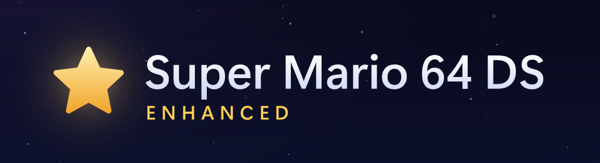
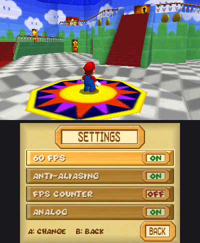

  

Super Mario 64 DS ported natively to the Nintendo 3DS, as an installable `.cia` you make
yourself from your own cartridge dump.

## Features

- **Widescreen.** The top screen upscales the game to the 3DS's full 400x240
- **60 fps.** Game logic is unchanged, but the 3DS draws in-between frames to
  make the game look nice and smooth, the way Nintendo should have in 2004
- **Stereoscopic 3D.** Turn up the 3D slider and the levels are drawn for each
  eye, with the in-between frames still on.
- **Anti-aliasing.** Smooths jagged edges in 3D scenes. It works while the 3D
  slider is off.
- **Analog controls.** The Circle Pad works as a real stick, so how far you
  push sets how fast you move. Turn it off for the DS's D-pad style controls.
  On a New 3DS the C-stick moves the camera.
- **Settings menu.** Press SELECT to change 60 fps, anti-aliasing, the FPS
  counter and analog controls.

  

## You'll need

- Windows 10 or 11
- Your own dump of the European release (game code ASMP), as an `.nds` file
- A 3DS or 2DS with custom firmware and FBI

## How to build

1. Download `SM64DS-Enhanced-Builder.zip` from [Releases](../../releases).
   Right-click it, choose Extract All, and run `SM64DS-Enhanced-Builder.exe`
   from the folder that makes. Keep the `builder-files` folder next to it.
2. Pick your dump, or drag it onto the window.
3. Click the settings button next to Build to choose your console (New 3DS or
   Old 3DS) and which options the game starts with: 60 fps, anti-aliasing, the
   FPS counter and analog controls. You can still change them in the game with
   SELECT.
4. Click Build. It takes a few seconds and saves the `.cia` next to your dump.
5. Copy the `.cia` to your SD card and install it with FBI.

The `.cia` has Nintendo's game data in it, so keep it to your own consoles.

## Source

Everything in the release is built from this repository:

- `port3ds/` is the 3DS port: the renderer, presentation and 3DS support
  (`src/`), the game's 3DS side (`game/`), vertex shaders (`shaders/`), and
  `upstream-patches/`, the changes to the decompilation's PC port.
- `port3ds/builder/` is the builder. Its `.exe` is built by
  [GitHub Actions](.github/workflows/builder.yml) from this source.
- [docs/BUILDING.md](docs/BUILDING.md) says how to build the game yourself.

The code here is under the [MIT licence](LICENSE). The decompilation and PC
port are tangosdev's, under their own MIT licence, and SIMDe
(`port3ds/third_party/simde`) and the tools in [THIRD-PARTY.txt](THIRD-PARTY.txt)
keep theirs. None of Super Mario 64 DS is in this repository.

## Code signing policy

The builder isn't signed yet: the project has applied to
[SignPath Foundation](https://signpath.org) for free code signing.

- Committers and reviewers: [ethanseagull](https://github.com/ethanseagull)
- Approvers: [ethanseagull](https://github.com/ethanseagull)

Every release's `.exe` is built by GitHub Actions from this repository, and
each signing is approved by hand.

### Privacy

The builder doesn't connect to the internet. It reads the dump you choose and
writes the `.cia`; nothing is sent anywhere. This program will not transfer any
information to other networked systems unless specifically requested by the
user or the person installing or operating it.

## Credits

This port is built on
[tangosdev's Super Mario 64 DS decompilation and PC port](https://github.com/tangosdev/sm64ds-decomp).
It also uses makerom, bannertool, libctru, citro3d and SIMDe; their licences
are in [THIRD-PARTY.txt](THIRD-PARTY.txt).

Super Mario 64 DS is Nintendo's. This is a fan project and isn't affiliated
with Nintendo.
